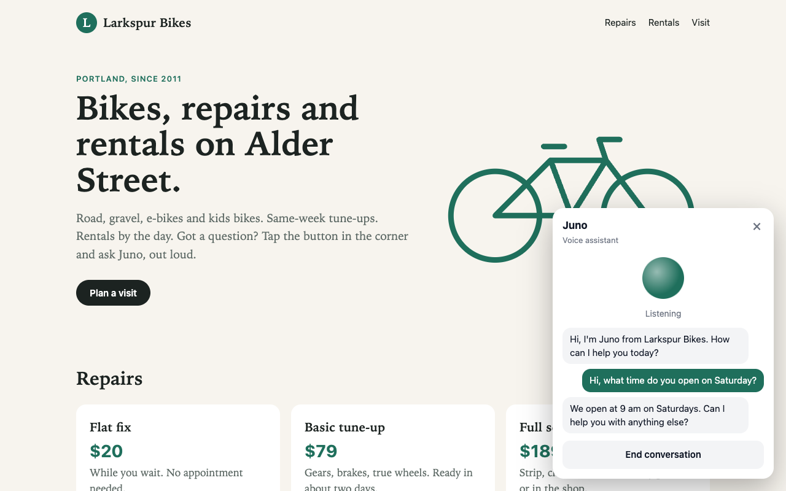

# Dialog-RSN-1 voice assistant for any website

A voice assistant you add to a website with one script tag. Visitors click the button, talk, and
hear the answer. Dialog-RSN-1 hears the audio, decides when they've finished, writes the reply and
speaks it.



- **The widget:** React 19, built by Vite 8 into one file, `dist/voice-assistant.js`, and packaged as a
  `<voice-assistant>` custom element in a shadow root, so it works on any page and the page's CSS can't break it.
- **The relay:** Express 5 and `ws`. It holds your key, sets the agent's instructions and voice, and only
  lets the browser send microphone audio.
- **The test website:** Larkspur Bikes, a fictional bike shop, plain HTML on its own origin.

## Run it

You need Node 22 or later and a Dialog-RSN-1 API key from [studio.poly.ai](https://studio.poly.ai):
sign up or log in, then create one in the **API Keys** tab.

```bash
npm install
cp .env.example .env    # add your POLY_API_KEY
npm start
```

Open http://localhost:3000, click the green button, then **Start talking**. Juno greets you; ask about
opening hours, repairs or e-bike rentals. Talk over an answer to interrupt it.

`npm run dev` rebuilds the widget and restarts the server when you change a file.

## What's in it

| File | What it does |
|---|---|
| `server.js` | Serves the widget on :8787, relays `/realtime` to Dialog-RSN-1, serves the test site on :3000 |
| `agent.js` | The agent: instructions, Cartesia voice id, and whether it greets first |
| `src/voice-session.js` | One conversation: microphone in, voice out, transcript. No framework |
| `src/audio/mic-worklet.js` | Audio-thread code: float samples to 16-bit PCM in 20 ms chunks |
| `src/audio/player.js` | Schedules the 24 kHz reply audio and flushes it on barge-in |
| `src/VoiceAssistant.jsx` | The React UI |
| `src/main.jsx` | Defines `<voice-assistant>` and mounts the React UI in a shadow root |
| `site/` | The Larkspur Bikes test website |

## Add it to your own site

```html
<script type="module" src="https://your-relay.example.com/voice-assistant.js"></script>
<voice-assistant name="Juno" style="--va-accent: #1f6f5c"></voice-assistant>
```

Then add your site's origin to `ALLOWED_ORIGINS` in `.env`. The relay refuses any page not on the list.
Serve both over HTTPS: browsers only allow the microphone on secure pages, and `localhost`.

| Attribute | Default | What it does |
|---|---|---|
| `name` | `Assistant` | The name in the panel header |
| `server` | `/realtime` on the server the script came from | The relay's WebSocket URL |
| `--va-accent` (CSS) | `#4338ca` | The button and highlight colour |

## Settings

| Variable | Default | What it does |
|---|---|---|
| `POLY_API_KEY` | none | Your Dialog-RSN-1 key |
| `DIALOG_REALTIME_URL` | `wss://api.studio.poly.ai/v1/realtime` | The Dialog-RSN-1 endpoint |
| `ALLOWED_ORIGINS` | `http://localhost:3000,http://127.0.0.1:3000` | Pages allowed to open the relay |
| `PORT`, `SITE_PORT` | `8787`, `3000` | Where the relay and the test site listen |

`npm start` reads `.env`, but a variable already set in your shell wins. If you get a 401 and the key in
`.env` is right, run `unset POLY_API_KEY` and start again.

## License

Apache 2.0. See [LICENSE](LICENSE).
